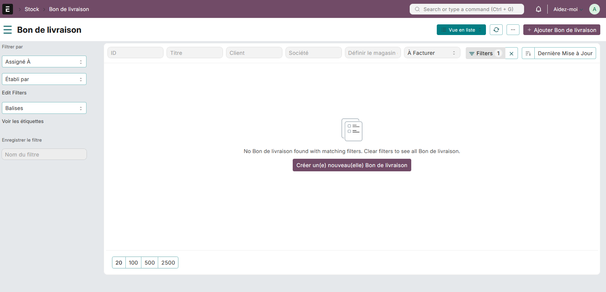
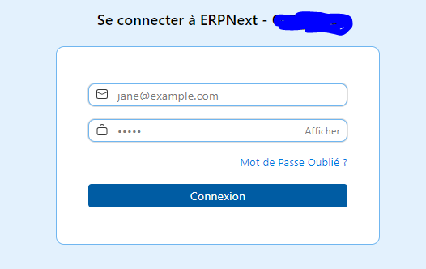

## C4Style

Frappe theme with an Odoo-inspired CSS design.

- Publisher: Connect 4 Systems
- Email: info@connect4systems.com



#### For login page:
<p>
Add the css file in Website Settings, Header TAB:<br>
&lt;link rel="stylesheet" href="/assets/c4style/css/c4style.css"&gt;
</p>


#### Style settings

Open **C4Style > Style Settings** inside Desk, or search for **Style Settings**. The native Single DocType is available at `/app/style-settings`. Only **System Manager** and **Website Manager** can read and edit it. The header settings button has been removed. The legacy **Open C4Style Settings** page is excluded from search; old bookmarks still redirect to Style Settings.

Each built-in palette supplies defaults for every theme color, including menu, component and announcement colors. **Reset palette colors** restores the selected preset before saving; explicit manager customizations remain saved until changed. Choose one of 17 palettes or customize primary, accent, page, card, header, table, menu and text/icon colors. The Single DocType has Theme, Navigation, Components, Announcement and Preview tabs. Components include capsule/flat headers, separated/flat rows, dashed/solid/no input borders, boxed/underline fields, filled/outline buttons and optional shadows. Typography, spacing and direction are configurable. Save to apply the shared Desk theme; other sessions receive changes after reloading. Old personal color overrides no longer override the manager's theme. Managers can enable **Users can choose their theme** (off by default). This adds **Choose my theme** to Appearance tools for every signed-in user. Each account can select one of the built-in palettes or **Use site theme**. The preference persists after refresh; turning the switch off applies the shared theme to everyone again. Enabling it later restores each account's saved choice. Personal selection changes colors only; shared typography, layout and permissions remain manager-controlled.

The edge-aligned navigation menu is available on workspace, list, and form pages. It builds links exclusively from Frappe's `allowed_workspaces` boot data, preserves private workspace routes and nested groups, and hides the duplicate workspace sidebar. New users start with an icon-only menu by default. Optional hover/focus expansion keeps their saved width preference. The legacy menu-mode switch has been removed so the menu position, colors and hover behavior stay consistent on every Desk page. The existing app logo opens a searchable workspace launcher.

Every signed-in Desk user can use the arrows in the menu to switch between a full menu with icons and labels and a narrow menu with icons only, or expand/narrow the workspace. Links keep tooltips and accessible labels in narrow mode. A third button switches text direction between RTL and LTR and moves the menu to match. These preferences save separately for each account and do not grant access to theme settings. Mobile navigation uses a horizontally scrollable layout; it is omitted from print output.

The floating **Appearance tools** button offers a searchable app launcher and private colored sticky notes. Menu width, workspace width and text direction remain in the menu controls. Each note has direct **Save**, **Minimize / Restore** and **Delete** actions in both the editor and floating window. Saved notes reopen automatically after refresh, including their minimized state. Notes remain draggable/resizable, with keyboard movement; window positions last for the page session. Save persists edits, Minimize keeps the note, and Delete removes it from your account. Managers also get a shared palette chooser with confirmation and a link to Style Settings. The header has no added settings button. The Appearance tools icon shows the account's unread notification count and includes **My notifications**. New notifications show a popup and a bell after the browser's first user interaction; before that, the popup offers **Enable bell sound**. Existing unread items are loaded silently. Read counts follow native mark-as-read actions, realtime events and a visible-tab refresh every 30 seconds. The user's native disabled-notifications preference suppresses popups and sound.

Configure the plain-text announcement (short and long messages scroll; font size is configurable from 10 to 48 pixels) in its own tab. Users can dismiss it for the page session. Navigation settings control scroll-to-top/bottom buttons and native notification/user side drawers. Animation respects reduced-motion preferences.

List views offer **Group loaded rows** for supported columns. Counts refer to currently loaded records. Filtering, sorting, selection and permissions remain managed by Frappe.

See [the video comparison](docs/video-reference-review.md) for implemented features, remaining differences and the synthetic layout preview.

After deploying the updated code, run these commands from the bench directory (replace `your-site` with your site name):

```sh
bench --site your-site migrate
bench build --app c4style
bench --site your-site clear-cache
bench restart
```

Desk asset URLs now include a content fingerprint so changed CSS/JavaScript files get new browser cache keys after deployment. Clear the site cache and restart workers after deploying hook changes. Saving Style Settings broadcasts an update after commit. Open sessions fetch the saved settings immediately through realtime events, when returning to the tab, and every 5 seconds as a fallback. Users with an allowed personal palette keep their chosen colors.

Hard-refresh the browser. Migration installs the Single DocType and the C4Style workspace shortcut. The retired `/app/c4style-settings` Page is removed; use `/app/style-settings`.

The visual direction is inspired by the [Kanak Infosystems theme walkthrough](https://www.youtube.com/watch?v=B_0SsIDih1k). This app implements its own styles and navigation; it does not include the vendor's theme code.

For standalone checks, run `python -B -m unittest discover -s tests -v`. Browser checks require Playwright and its Chromium browser. Full Frappe migration and permissions should also be verified on the target site.

#### License

mit

Authenticated regression checks with browser-local assets can be run with:

```sh
python -B tests/run_regression_review.py --base-url https://your-site --session-file /temporary/session.json
```

This check temporarily saves shared style options and restores the original settings in `finally`, then verifies them after reload. It does not deploy local app files. Use a test site or an agreed testing window.

To check the actual deployed assets without overriding them:

```sh
python -B tests/run_menu_review.py --base-url https://your-site --session-file /temporary/session.json --output artifacts/deployed-review
```

Add `--local-assets` only when deliberately testing local public files against the live server. The default performs read-only checks of deployed files.

#### Notifications

Create notifications manually using Frappe's Notification form. C4Style's workflow
notification extension has been removed; Administration handles approval actions.
After upgrading, run site migration to remove the retired custom controls.

#### Theme Platte Colors

System Manager and Website Manager can manage **Theme Platte Color** records, including
adding, editing, renaming, deleting and enabling them. Only enabled records are
offered in Style Settings and Appearance tools. Selecting a palette fetches its
saved colors; site colors can still be customized afterward. Personal selection
also requires **Users can choose their theme** in Style Settings.

Run site migration after upgrading. It creates the DocType, converts the palette
selector to a Link and imports the existing 17 palettes once. Future migrations
preserve edited, renamed and deleted records. Disabling or deleting a personal
palette restores the shared theme on refresh. Existing shared colors remain saved
until a manager selects a palette again or edits them. Rename preserves personal
selections. Manual colors previously selected as Custom are preserved with an
empty palette Link.

After this upgrade, run `bench --site your-site migrate`, clear the site cache and restart. The migration renames Color Palette to Theme Platte Color while preserving palette records and links, and deletes the retired c4style-settings Page.
